# Lokna V3.3 — Stratégie SEO & Architecture d'Acquisition Organique

> **Date** : 16 octobre 2026  
> **Branche de travail** : `feat/free-tools-seo-v3-3`  
> **Auteur** : Équipe SEO technique, contenu et juridique Lokna

---

## 1. Principes Directeurs de la Stratégie V3.3

### A. Réponse Immédiate (Above the Fold)
L'outil interactif est positionné **dès le haut de page** sous le titre et une brève introduction de 2 phrases. L'utilisateur n'est jamais forcé de faire défiler 1 500 mots de texte générique avant d'accéder au simulateur ou au formulaire.

### B. Contenu d'Accompagnement Utile (Post-Calcul)
Le contenu textuel situé sous le banc de travail remplit 4 objectifs précis :
1. **Expliquer les résultats** et les formules de calcul appliquées.
2. **Citer les textes légaux en vigueur** (Légifrance, Service-Public.fr, INSEE).
3. **Mettre en garde contre les erreurs fréquentes** et les sanctions encourues.
4. **Répondre aux questions spécifiques** via une FAQ unique à la page.

### C. Conversion Non Intrusive
Aucun paywall, aucun blocage de résultat et aucune obligation de renseigner un e-mail. Les CTA Lokna sont **contextualisés** en fonction du problème résolu par l'outil (ex. : gestion mensuelle automatisée après une quittance, suivi des baux après un calcul de préavis).

---

## 2. Clusters Thématiques et Maillage Interne

```mermaid
graph TD
  Hub["Hub /outils"] --> ClusterQuittance["Cluster Quittance"]
  Hub --> ClusterIRL["Cluster Révision IRL"]
  Hub --> ClusterCharges["Cluster Charges"]
  Hub --> ClusterBail["Cluster Bail & Gestion"]
  Hub --> ClusterInvest["Cluster Investissement & Fiscalité"]

  subgraph "Cluster Quittance"
    Q1["/outils/generateur-quittance"]
    Q2["/outils/modele-quittance-loyer-pdf"]
    Q3["/templates/modele-quittance-de-loyer"]
    Q4["/quittances (Produit)"]
    Q1 <--> Q2
    Q2 --> Q3
    Q1 --> Q4
  end

  subgraph "Cluster Révision IRL"
    IRL1["/outils/calculateur-irl"]
    IRL2["/guides/irl-2026"]
    IRL3["/templates/augmentation-de-loyer"]
    IRL4["/glossaire-immobilier/irl-indice-reference-loyers"]
    IRL1 <--> IRL2
    IRL1 --> IRL3
    IRL1 --> IRL4
  end

  subgraph "Cluster Charges"
    CH1["/outils/calculateur-charges-locatives"]
    CH2["/blog/charges-locatives-recuperables-liste-2026"]
    CH3["/templates/repartition-charges"]
    CH1 <--> CH2
    CH1 --> CH3
  end

  subgraph "Cluster Bail & Gestion"
    B1["/outils/calculateur-depot-garantie"]
    B2["/outils/calculateur-preavis"]
    B3["/outils/checklist-etat-lieux"]
    B4["/outils/calculateur-surface-habitable"]
    B5["/outils/lettre-relance-loyer"]
    B6["/outils/generateur-conge-vente"]
    B7["/templates/bail-vide"]
    B8["/templates/etat-des-lieux"]
    B1 <--> B2
    B3 <--> B8
    B4 --> B7
    B5 --> B7
    B6 --> B2
  end

  subgraph "Cluster Investissement & Fiscalité"
    INV1["/outils/calculateur-rendement"]
    INV2["/outils/calculateur-loyer"]
    INV3["/outils/simulateur-pret-immobilier"]
    INV4["/outils/calculateur-plus-value"]
    INV5["/outils/simulateur-fiscalite-lmnp"]
    INV6["/outils/simulateur-loi-jeanbrun"]
    INV1 <--> INV2
    INV1 <--> INV3
    INV5 <--> INV6
    INV4 --> INV1
  end
```

---

## 3. Stratégie Anti-Cannibalisation

Pour éviter que des pages proches ne se fassent concurrence sur les mêmes requêtes Google, chaque URL possède un angle d'intention et un ciblage sémantique distincts :

| Paire à risque | URL 1 & Intention | URL 2 & Intention | Frontière sémantique |
| :--- | :--- | :--- | :--- |
| **Quittance** | `/outils/generateur-quittance` *Générateur immédiat PDF* | `/outils/modele-quittance-loyer-pdf` *Modèle type & trame légale* | URL 1 cible la requête transactionnelle (*« générer quittance »*). URL 2 cible la requête informationnelle et documentaire (*« modèle quittance pdf gratuit »*, anatomie des clauses). |
| **Charges** | `/outils/calculateur-charges-locatives` *Calcul de solde de régularisation* | `/blog/charges-locatives-recuperables-liste-2026` *Nomenclature décret 1987* | L'outil calcule la différence arithmétique provisions / réelles. L'article détaille la liste exhaustive des charges récupérables et non récupérables (TEOM, ascenseur, eau). |
| **Loyer** | `/outils/calculateur-loyer` *Prorata jours réels + Loyer m²* | `/outils/calculateur-irl` *Évolution annuelle indexée INSEE* | L'un calcule le loyer initial et le prorata d'entrée/sortie ; l'autre calcule l'évolution annuelle du loyer en cours de bail selon l'indice INSEE. |
| **Congé & Fin de bail** | `/outils/calculateur-preavis` *Durée & date d'échéance* | `/outils/generateur-conge-vente` *Courrier formel avec préemption* | L'un est un calculateur de date calendrier de quantième à quantième ; l'autre est un générateur de courrier d'offre de vente notifié 6 mois avant l'échéance. |
| **État des lieux** | `/outils/checklist-etat-lieux` *Checklist interactive de visite* | `/templates/etat-des-lieux` *Document type à télécharger* | L'un permet le pointage interactif pièce par pièce le jour de la remise des clés ; l'autre est la consultation de la trame type du contrat. |

---

## 4. Données Structurées (JSON-LD) Conformes

Conformément aux consignes de qualité Google Search Central :
1. **Émission unique** : Toutes les données structurées sont regroupées dans un seul nœud `@graph` généré côté serveur dans le `page.tsx` via `buildGraphSchema`.
2. **Pas de doublons** : Suppression formelle des déclarations multiples de `BreadcrumbList` et `WebApplication` qui encombraient les anciens composants clients.
3. **Schémas appliqués par page** :
   - `WebApplication` : description de l'outil, gratuité (`isAccessibleForFree: true`), applicationCategory (*FinanceApplication* ou *BusinessApplication*).
   - `BreadcrumbList` : fil d'Ariane hiérarchique (*Accueil > Outils > [Outil]*).
   - `HowTo` : appliqué lorsque le calcul suit des étapes séquentielles explicites (ex. révision IRL, régularisation de charges).
   - `FAQPage` : appliqué aux questions/réponses spécifiques de la page (non dupliquées).

---

## 5. Matrice des Métadonnées et Balises H1

| URL | Titre SEO (Title) | Balise H1 unique | Balise Description |
| :--- | :--- | :--- | :--- |
| `/outils` | Outils Immobiliers Gratuits 2026 — Calculateurs & Générateurs | Outils Immobiliers Gratuits pour Propriétaires | Accédez à nos calculateurs immobiliers gratuits 2026 : révision IRL, rendement, dépôt de garantie, charges locatives. Outils professionnels pour bailleurs. |
| `/outils/generateur-quittance` | Générateur de Quittance de Loyer Gratuit en Ligne (PDF 2026) | Générateur de quittance de loyer PDF | Remplissez et téléchargez gratuitement votre quittance de loyer PDF ou reçu partiel conforme à la loi du 6 juillet 1989. Sans inscription ni frais. |
| `/outils/modele-quittance-loyer-pdf` | Modèle de Quittance de Loyer PDF Gratuit (2026) — Exemple Conforme | Modèle de quittance de loyer PDF gratuit (conforme loi de 1989) | Téléchargez notre modèle de quittance de loyer PDF gratuit 2026. Exemple conforme loi 1989 avec distinction loyer et charges. Sans inscription. |
| `/outils/calculateur-irl` | Calculateur IRL 2026 — Indice de Référence des Loyers | Calculateur IRL — Indice de Référence des Loyers | Calculez l'augmentation de votre loyer avec le dernier indice IRL officiel publié par l'INSEE. Formule légale, historique et explications sans inscription. |
| `/outils/calculateur-charges-locatives` | Calculateur de Charges Locatives 2026 — Régularisation Annuelle | Calculateur de Charges Locatives | Calculez la régularisation annuelle des charges locatives : provisions versées contre dépenses réelles. Gratuit, conforme au décret de 1987. |
| `/outils/lettre-relance-loyer` | Modèle Lettre de Relance Loyer Impayé — Rappel & Mise en Demeure | Générateur de lettre de relance de loyer impayé | Générez gratuitement votre lettre de relance pour loyer impayé : rappel amiable ou mise en demeure en LRAR conforme à l'article 24 de la loi de 1989. |
| `/outils/generateur-conge-vente` | Lettre Congé pour Vente Gratuit — Modèle Préavis Propriétaire | Générateur de congé pour vente (bail vide et meublé) | Rédigez votre lettre de congé pour vente conforme à l'article 15 II de la loi de 1989. Préavis de 6 mois, droit de préemption et mentions obligatoires. |
| `/outils/calculateur-rendement` | Calculateur Rendement Locatif — Brut, Net & Cash-flow | Calculateur de rentabilité et rendement locatif | Calculez la rentabilité locative brute et nette de charges de votre investissement immobilier. Simulation détaillée et gratuite sans inscription. |
| `/outils/calculateur-loyer` | Calculateur Prorata de Loyer & Loyer au m² 2026 | Calculateur de prorata de loyer et de loyer au m² | Calculez le prorata de loyer en jours réels pour une entrée ou sortie en cours de mois, et estimez le loyer au m² avec plafonds d'encadrement. |
| `/outils/simulateur-pret-immobilier` | Simulateur Prêt Immobilier — Mensualité & Amortissement | Simulateur de prêt immobilier et tableau d'amortissement | Calculez vos mensualités de crédit immobilier, le coût total avec assurance et visualisez votre tableau d'amortissement annuel. Gratuit et sans inscription. |
| `/outils/calculateur-plus-value` | Calculateur Plus-Value Immobilière 2026 — Impôt & Abattements | Calculateur de plus-value immobilière | Estimez la plus-value immobilière nette et l'impôt à la revente : abattements pour durée de détention (22 et 30 ans), forfaits et surtaxe éventuelle. |
| `/outils/simulateur-fiscalite-lmnp` | Simulateur Fiscalité LMNP 2026 — Micro-BIC vs Régime Réel | Simulateur de fiscalité LMNP (Micro-BIC vs Régime Réel) | Comparez le régime Micro-BIC (abattement 50 %) et le Régime Réel avec amortissement du bâti et du mobilier selon l'article 39 C du CGI. |
| `/outils/simulateur-loi-jeanbrun` | Simulateur Loi Jeanbrun 2026 — Amortissement Statut Bailleur Privé | Simulateur loi Jeanbrun : amortissement dégressif sur 9 ans vs LMNP | Simulez l'amortissement fiscal sur 9 ans (5,5 % / 4,5 % / 3,5 %) du statut du bailleur privé en location nue face au Micro-BIC et au LMNP. |
| `/outils/calculateur-depot-garantie` | Calculateur Dépôt de Garantie 2026 — Plafond & Restitution | Calculateur de dépôt de garantie : plafond légal et restitution | Calculez le montant légal du dépôt de garantie (1 mois vide, 2 mois meublé), les délais de restitution, retenues en copropriété et pénalités de retard. |
| `/outils/calculateur-preavis` | Calculateur Préavis Location — 1 ou 3 Mois (Zone Tendue) | Calculateur de préavis de location (locataire et propriétaire) | Déterminez la durée légale de préavis de départ (1 mois en meublé ou zone tendue, 3 mois en vide) et la date exacte d'expiration de quantième à quantième. |
| `/outils/checklist-etat-lieux` | Checklist État des Lieux Entrée & Sortie (Décret 2016-382) | Checklist d'état des lieux d'entrée et de sortie | Grille complète d'état des lieux d'entrée et de sortie conforme au décret n° 2016-382. Relevé des compteurs, inventaire des clés et contrôle pièce par pièce. |
| `/outils/calculateur-surface-habitable` | Calculateur Surface Habitable Loi Boutin — Écart 5 % Bail | Calculateur de surface habitable (loi Boutin) | Mesurez la surface habitable conforme à la loi Boutin (art. R. 156-1 CCH) et vérifiez le seuil d'écart de 5 % avec la surface inscrite dans le bail. |

---

## 6. Références et Sources Réglementaires Officielles

Chaque formule et affirmation juridique implémentée dans les outils s'appuie sur une source légale datée et vérifiée :

1. **Loi n° 89-462 du 6 juillet 1989** (modifiée par les lois ALUR, ELAN et loi n° 2023-668 du 27 juillet 2023) :
   - *Article 3-1* : Obligation de mention de la surface habitable dans le bail et diminution de loyer si écart > 1/20e.
   - *Article 3-2* : Modalités de l'état des lieux contradictoire et délai de recours de 10 jours.
   - *Article 4 p* : Nullité de plein droit des clauses imposant des frais de relance ou d'impayé au locataire.
   - *Article 7 a* : Obligation de paiement ponctuel du loyer et des charges.
   - *Article 15* : Congé délivré par le locataire (3 mois ou 1 mois) et congé pour vente du bailleur (6 mois, droit de préemption).
   - *Article 17-1* : Révision annuelle indexée sur l'IRL sans effet rétroactif.
   - *Article 21* : Délivrance gratuite de la quittance de loyer ou du reçu partiel.
   - *Article 22* : Dépôt de garantie en location vide (1 mois HC max, restitution sous 1 ou 2 mois, retenue copropriété 20 %, pénalité 10 %/mois).
   - *Articles 25-6, 25-8, 25-14, 25-17* : Régimes spécifiques de la location meublée (2 mois de dépôt, préavis locataire 1 mois, congé bailleur 3 mois sans préemption) et du bail mobilité (dépôt interdit, fin sans congé).
2. **Décret n° 87-713 du 26 août 1987** : Liste exhaustive des charges locatives récupérables.
3. **Décret n° 2016-382 du 30 mars 2016** : Modalités d'établissement de l'état des lieux et grille de vétusté.
4. **Code général des impôts (CGI)** :
   - *Articles 150 U à 150 VH* : Régime des plus-values immobilières des particuliers (abattements 22 et 30 ans).
   - *Article 1609 nonies G* : Taxe sur les plus-values immobilières supérieures à 50 000 €.
   - *Article 50-0* : Régime Micro-BIC (abattement forfaitaire 50 % jusqu'à 77 700 €).
   - *Article 39 C* : Limitation de la déduction des amortissements en régime réel (interdiction de créer un déficit fiscal).
5. **INSEE** : Séries officielles de l'Indice de Référence des Loyers (IRL) publiées chaque trimestre.
6. **Code de procédure civile** :
   - *Article 641* : Décompte des délais exprimés en mois (de quantième à quantième, expiration au dernier jour du mois à défaut de quantième identique).
   - *Article 1344 du Code civil* : Régime de la mise en demeure de payer.
